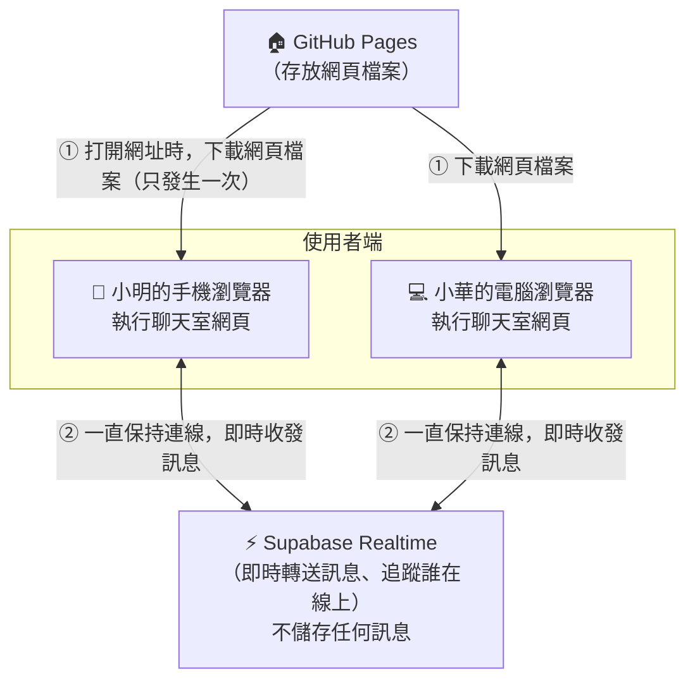
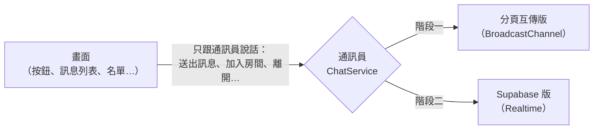
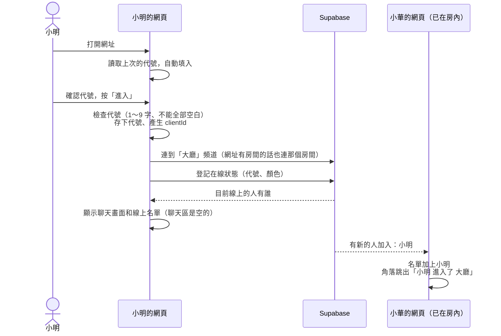
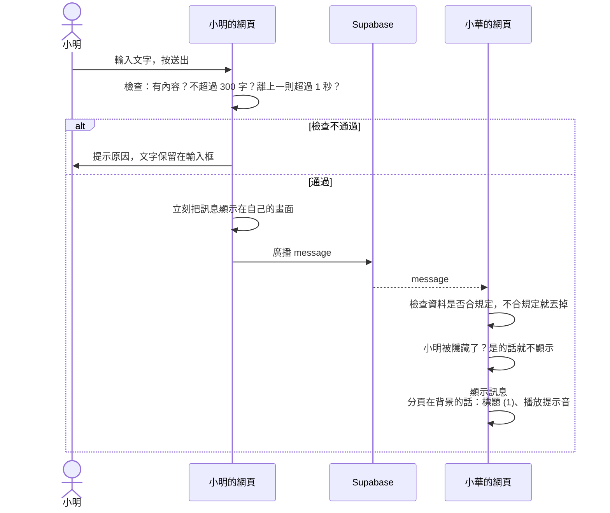
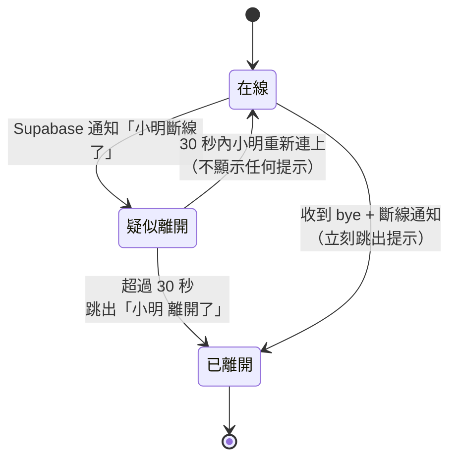
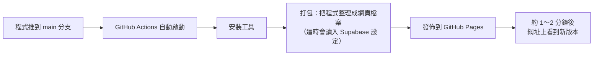

# 匿名聊天室 架構文件

> 依據：`docs/requirements.md`，以及需求訪談（共 17 題）確認過的決定。
> 寫給誰看：不寫程式的專案負責人，也給之後實際寫程式的人參考。
> 專有名詞第一次出現時，會用 **粗體**，並在後面用一句話解釋。

---

## 1. 專案說明與目標

### 1.1 這是什麼
一個**不用註冊、不用登入**的匿名聊天室網站。打開網址、輸入代號，就能和其他人即時聊天。電腦和手機都能用。

### 1.2 目標
1. 任何拿到網址的人，30 秒內就能開始聊天。
2. 訊息即時出現，不需要重新整理網頁。
3. 看得到誰在線上，有人進出時會收到提示。
4. 除了大家共用的「大廳」，也可以開只有拿到連結的人才進得來的私人房間。
5. **不保存任何聊天紀錄**：訊息送出、大家看完就沒了，網站本身不留下任何紀錄。
6. **完全免費**：使用 GitHub 和 Supabase 的免費方案。

### 1.3 使用者會看到的完整功能
| 類別 | 功能 |
|---|---|
| 進入 | 輸入代號（1～9 個字，中間可以有空白，空白也算字數，不能全部都是空白）。下次打開時，會自動帶入上次的代號。 |
| 代號重複 | 可以重複。每個人有自己的名字顏色，靠顏色分辨。 |
| 房間 | 直接打開網站就進大廳。也可以開私人房間（名字可取可不取），用連結邀請別人。一個人可以同時在好幾個房間。 |
| 訊息 | 只看得到進來之後的訊息。全部靠左排列，每則都有名字和時間（例如 20:15）。自己的訊息會標上「（你）」。每則最多 300 字，網址可以點。 |
| 互動 | 可以回覆或引用某則訊息。可以加表情回應（👍 ❤️ 😂 😮 😢），滑鼠移上去或手機長按，可以看到是誰按的。 |
| 防洗版 | 每秒最多送 1 則。可以點別人的名字「隱藏」他，只有自己看不到，而且只在這次有效。 |
| 線上名單 | 電腦版放在右側欄；手機版收起來，只顯示「👥 5 人在線」，點了才展開。 |
| 進出提示 | 畫面角落跳出浮動通知，幾秒後自動消失。 |
| 斷線 | 30 秒內回來就當作沒離開。回來時自動重新連線，不用重新輸入代號。 |
| 離開 | 有「離開」按鈕，按了回到輸入代號的畫面。 |
| 新訊息提醒 | 沒在看這個分頁時，分頁標題會顯示未讀數並播放提示音。可以靜音。 |

---

## 2. 整體架構圖



**這張圖的意思：**
- **GitHub Pages**（GitHub 提供的免費網站空間）：就像「傳單發放處」。使用者打開網址時，它把網頁檔案交給瀏覽器，之後就不再參與聊天。
- **Supabase**（一個提供線上後台服務的平台，有免費方案）：就像「廣播站」。每個人的瀏覽器都連著它，有人說話，它就轉給同一個房間的所有人。**它只負責轉送，不會把訊息存起來。**
- 我們**沒有自己的伺服器**（伺服器：一直開著、負責處理資料的電腦），也**沒有資料庫**（資料庫：長期存放資料的地方）。

---

## 3. 技術選擇

### 3.1 前端（使用者在瀏覽器裡看到、操作的那一部分）

| 項目 | 選了什麼 | 為什麼 |
|---|---|---|
| 程式語言 | **TypeScript**（JavaScript 的加強版，寫程式時要先講清楚每份資料長什麼樣子） | 聊天室裡，訊息、表情回應、線上名單會在很多人之間傳來傳去。先把資料格式定清楚，寫錯時電腦會立刻提醒，不用等到上線才出問題。 |
| 框架 | **React**（一套做網頁畫面的工具，資料一變，畫面會自動更新） | 這個聊天室的畫面一直在變：新訊息、表情數字、線上人數、未讀數。React 最擅長這種情況。`/frontend-design` 產出的畫面通常也是 React，可以直接沿用。 |
| 打包工具 | **Vite**（把寫好的程式整理成瀏覽器能直接讀的網頁檔案的工具） | 設定簡單、速度快，產出的檔案可以直接放上 GitHub Pages。 |
| 網址格式 | **Hash 網址**（網址裡有 `#`，例如 `.../#/r/abc123`） | GitHub Pages 只會照檔名找檔案。如果網址是 `.../r/abc123`，重新整理時它會找不到檔案，顯示「找不到網頁」。`#` 後面的部分不會送到 GitHub，而是由我們的網頁自己處理，就不會有這個問題。 |
| 畫面樣式 | 純 CSS（CSS：決定顏色、大小、排版的語言），不使用現成的樣式套件 | 畫面要完全照 `/design` 的設計走。用現成套件的話，常常要花力氣去改掉它原本的樣子。 |

### 3.2 Supabase 用哪個功能

Supabase 有很多功能，我們只用其中的 **Realtime**（即時通訊服務）。它透過 **WebSocket**（讓瀏覽器和伺服器之間一直保持連線、隨時可以互傳資料的技術）運作。

Realtime 裡面又分三種功能：

| 功能 | 用不用 | 說明 |
|---|---|---|
| **Broadcast**（廣播：把一段資料轉給同一個房間裡的所有人） | ✅ 用 | 傳送聊天訊息、表情回應、「我要離開了」的通知。**轉送完就忘掉，不會存起來**，剛好符合「不保存聊天紀錄」。 |
| **Presence**（在線狀態：自動記錄誰還連著，有人加入或斷線就通知大家） | ✅ 用 | 做線上名單和進出提示。Supabase 會自動偵測誰斷線，我們不用自己判斷。 |
| Postgres Changes（資料庫變動通知） | ❌ 不用 | 這要先把訊息存進資料庫才會用到。我們不存訊息，所以不需要。 |

**其他 Supabase 功能都不用**：不用資料庫、不用登入系統、不用檔案儲存空間、不用伺服器端程式。

**頻道**（Supabase 裡的「一個房間」：連到同一個頻道的人，會收到彼此的廣播）的命名方式：
- 大廳：`room:lobby`
- 私人房間：`room:` 加上房間 ID（例如 `room:k3f9xa2m7qpd`）

一個人同時在好幾個房間，就是同時連到好幾個頻道。這些頻道會共用同一條 WebSocket 連線，不會多佔 Supabase 的連線數。

---

## 4. 兩個階段

### 4.1 階段一：還沒接 Supabase

**做到什麼程度：** 第 1.3 節的功能**全部做完**，畫面也照 `/design` 的設計做好。唯一的差別是：訊息只能在「**同一台電腦、同一個瀏覽器**」的不同分頁之間傳遞。

**怎麼做到的：** 瀏覽器內建一個叫 **BroadcastChannel**（瀏覽器內建功能，讓同一個瀏覽器的不同分頁互相傳話）的功能，不需要任何外部服務。開兩個分頁，就像兩個人在聊天。

**在 GitHub Pages 上怎麼看效果：**
1. 用電腦打開 GitHub Pages 的網址，輸入代號「小明」。
2. 在**同一個瀏覽器**再開一個新分頁，打開同一個網址，輸入代號「小華」。
3. 兩個分頁可以互相聊天、看到彼此在線上、收到進出提示、加表情回應。
4. 開私人房間：在小明的分頁建立房間、複製連結，貼到第三個分頁打開。

畫面頂端會有一條提示：「**展示模式：只能和這個瀏覽器的其他分頁聊天**」，避免拿去給別人試的時候被誤會成壞掉。

> 手機和電腦之間在階段一**不能**互相聊天。這是預期中的行為，不是錯誤。

### 4.2 階段二：接上 Supabase

**會改變的：**
- 電腦、手機，不同人、不同地方，都能真的即時聊天。
- 「展示模式」提示消失。
- 30 秒斷線緩衝會在真實情況下發揮作用，例如手機鎖螢幕、切換 App、網路不穩。

**不會改變的：** 畫面、按鈕、功能、操作方式，全部一樣。

### 4.3 怎麼設計才不用整個重寫

關鍵在於加一層「**通訊員**」（程式裡叫 `ChatService`）。



- 畫面**永遠不會直接**接觸 BroadcastChannel 或 Supabase，只會告訴通訊員：「幫我送出這則訊息」、「有新訊息時通知我」。
- 通訊員有兩個版本，**對畫面來說，兩個版本的用法一模一樣**。
- 階段二只要**新增** Supabase 版的通訊員就好，畫面那一側完全不用動。
- 用哪個版本是自動判斷的：有設定 Supabase 金鑰（見第 8 節）就用 Supabase 版，沒有就用分頁互傳版。所以即使到了階段二，沒有金鑰的開發電腦還是能用展示模式測試。
- 兩個版本使用**同一套通訊約定**（第 5 節）和**同一套 30 秒緩衝規則**（第 6.4 節），這兩部分只寫一次，兩個版本共用。

通訊員要提供給畫面的能力：

| 能力 | 說明 |
|---|---|
| 加入房間 | 告訴大家「我進來了」，開始接收這個房間的訊息 |
| 送出訊息 | 把一則訊息廣播給房間裡的人 |
| 送出表情回應 | 加上或取消一個表情 |
| 離開房間 | 告訴大家「我走了」，停止接收 |
| 通知：收到新訊息 | |
| 通知：收到表情回應 | |
| 通知：線上名單變了 | |
| 通知：有人進來／有人離開 | 已經套用過 30 秒緩衝 |
| 通知：連線狀態變了 | 「已連線」或「重新連線中」 |

---

## 5. 通訊約定

所有在使用者之間傳遞的資料，都用 **JSON**（一種用文字表示資料的通用格式，長得像 `{"名稱": "值"}`）表示。下面的範例中，`//` 後面的文字是說明，不是資料的一部分。

### 5.1 每個人的身分（沒有登入，只有臨時身分）

| 欄位 | 意思 | 怎麼來 |
|---|---|---|
| `clientId` | 這個人這次進入時的編號，別人看不到 | 進入時隨機產生一串很長的亂碼。存在 **sessionStorage**（瀏覽器幫單一分頁暫存資料的地方，關掉分頁就清掉）裡，所以重新整理時編號不變；開新分頁就會換一個。**一個分頁就是一個人。** |
| `nickname` | 代號 | 使用者輸入。存在 **localStorage**（瀏覽器幫網站長期保存小資料的地方，關掉瀏覽器也還在）裡，下次自動帶入。 |
| `color` | 名字顏色 | 由 `clientId` 算出來，從 12 種好辨識的顏色中選一個。同一個 `clientId` 一定算出同一個顏色，所以每個房間都一樣。 |

### 5.2 廣播事件（Broadcast）

#### 事件 `message`：一則聊天訊息
```json
{
  "id": "6f1c2a…",            // 這則訊息的編號（隨機產生）
  "clientId": "a83b…",        // 發送者的編號
  "nickname": "小明",
  "color": "#2F80ED",
  "text": "大家好 https://example.com",   // 最多 300 字
  "replyTo": {                 // 如果是回覆別人才有，沒有就省略
    "id": "91de…",             // 被回覆那則訊息的編號
    "nickname": "小華",
    "excerpt": "今天晚上要不要一起…"   // 被回覆內容的前 50 字
  }
}
```
> 為什麼回覆時要附上原文摘要？因為不保存歷史，後來才進來的人手上沒有原訊息，附上摘要才看得懂在回覆什麼。

#### 事件 `reaction`：表情回應
```json
{
  "messageId": "6f1c2a…",     // 對哪一則訊息
  "emoji": "👍",               // 只能是 👍 ❤️ 😂 😮 😢 其中一個
  "clientId": "a83b…",
  "nickname": "小華",
  "on": true                   // true = 加上，false = 取消
}
```

#### 事件 `bye`：我按了「離開」
```json
{ "clientId": "a83b…" }
```
> 用途：讓其他人**立刻**顯示「小明 離開了」，不用等 30 秒。

### 5.3 在線狀態（Presence）

每個人連上頻道後，會登記以下資料，Supabase 會自動通知大家：
```json
{
  "clientId": "a83b…",
  "nickname": "小明",
  "color": "#2F80ED",
  "joinedAt": 1760000000000    // 進入的時間
}
```

### 5.4 其他約定
- **時間顯示**：用「**收到訊息時，自己電腦的時間**」。如果用發送者電腦的時間，對方時鐘不準時，訊息順序會亂掉。
- **自己的訊息**：按下送出就直接出現在自己的畫面上，不等繞一圈回來。
- **房間網址**：
  - 大廳：`https://<帳號>.github.io/<repo 名稱>/#/`
  - 私人房間：`https://<帳號>.github.io/<repo 名稱>/#/r/<房間ID>?name=<房間名稱>`
  - **房間 ID**：12 個隨機英文字母和數字，可能的組合多到幾乎猜不到，所以「拿到連結才進得來」就是靠這個保護。
  - 房間名稱直接放在網址裡，因為沒有資料庫可以存。沒取名時顯示「房間 」加上 ID 前 4 碼。

---

## 6. 資料流

### 6.1 進入聊天室



### 6.2 送出訊息



表情回應的流程相同，只是事件換成 `reaction`，收到的人會更新訊息下方的表情數字。

### 6.3 主動離開（按「離開」按鈕）

1. 小明的網頁對每個房間廣播 `bye`。
2. 取消在線登記，中斷所有頻道。
3. 清除暫存的房間清單，回到輸入代號畫面（代號保留，方便換個代號再進來）。
4. 其他人收到 `bye`，再收到 Supabase 的「小明斷線了」後，**立刻**把小明從名單移除，並跳出「小明 離開了」。

> 為什麼要「兩個都收到」才算？如果只看 `bye`，有心人可以假冒別人送 `bye`，讓別人看起來像離開了。Supabase 的斷線通知沒辦法假冒，所以兩個都要有。

### 6.4 斷線與重新連線（30 秒緩衝）



**其他人那邊看到的：**
- 小明斷線後的 30 秒內，他**還留在線上名單上**，畫面不會有任何變化。
- 30 秒內小明連回來：什麼事都沒發生。
- 超過 30 秒：小明從名單消失，跳出「小明 離開了」。之後他再連回來，就是一般的「小明 進入了」。

**小明自己這邊看到的：**
1. 網路斷掉，或手機切到背景後再回來。
2. 畫面頂端顯示「**連線中斷，重新連線中…**」，這段時間不能送出訊息。
3. 連線恢復後：自動重新登記在線狀態，頂端的提示消失，聊天區插入一行灰字：「— 連線中斷期間的訊息無法顯示 —」。
4. 不需要重新輸入代號，所在的房間也全部保留。

**重新整理網頁**也走同一套流程：`clientId` 不變，所以只要 30 秒內回來，別人就不會看到進出提示。

---

## 7. 畫面清單

> 這裡只規定「有什麼東西」和「做什麼事」，顏色、字體、大小、位置細節交給 `/design`。

### 7.1 輸入代號畫面
| 元素 | 行為 |
|---|---|
| 標題／簡短說明 | 說明這是匿名聊天室、不保存訊息 |
| 代號輸入框 | 自動填入上次的代號。旁邊顯示「3 / 9」字數。超過 9 字時不能再輸入 |
| 「進入」按鈕 | 代號不合規定（空的、全部是空白）時，按鈕不能按，並顯示原因。按 Enter 鍵也能進入 |
| 要前往的房間名稱 | 如果是從私人房間連結進來的，顯示「你將進入：週五讀書會」 |
| 展示模式提示 | 只在階段一出現 |

### 7.2 聊天主畫面（電腦版：左中右三欄）

**左欄：房間列表**
| 元素 | 行為 |
|---|---|
| 「大廳」 | 永遠在第一個，不能關掉 |
| 每個私人房間 | 顯示房間名稱和未讀數（例如「週五讀書會 3」）。點了就切換過去。旁邊有「×」可以離開這個房間（會向該房間廣播 `bye`） |
| 「＋ 開新房間」按鈕 | 打開 7.3 建立房間視窗 |

**中間：聊天區**
| 元素 | 行為 |
|---|---|
| 頂端列 | 房間名稱；私人房間有「複製連結」按鈕；靜音按鈕（🔔／🔕）；「離開」按鈕（回到輸入代號畫面，會離開所有房間） |
| 連線狀態列 | 斷線時才出現：「連線中斷，重新連線中…」 |
| 展示模式提示 | 只在階段一出現 |
| 訊息列表 | 由上往下，最新的在最下面。使用者停在最底下時，新訊息來會自動捲動；使用者往上捲在看舊訊息時不自動捲動，改成顯示「↓ 有新訊息」按鈕 |
| 剛進房間時的空狀態 | 「還沒有訊息。你進來之前的訊息不會顯示。」 |
| 系統灰字 | 只有「連線中斷期間的訊息無法顯示」這一種（進出提示用浮動通知，不放在這裡） |
| 輸入區 | 見下表 |

**每一則訊息**
| 元素 | 行為 |
|---|---|
| 名字 | 用這個人的顏色顯示。自己的後面加「（你）」。點別人的名字會出現選單：「隱藏這個人」 |
| 時間 | `HH:mm`，例如 20:15 |
| 引用區塊 | 回覆別人時才有：顯示被回覆的人和內容前 50 字。點了會捲到原訊息並短暫標亮；原訊息不在畫面上時，就不做任何事 |
| 內容 | 純文字，換行照原樣顯示；網址可以點，會在新分頁打開 |
| 自己的訊息 | 有淡色底，和別人的區分開來 |
| 操作按鈕 | 滑鼠移上去時出現（手機：長按訊息）：「回覆」、加表情（5 個可選） |
| 表情列 | 例如「👍 3　😂 1」。自己有按的會標亮，點一下可以加上或取消。滑鼠移上去或長按，會顯示是誰按的 |

**輸入區**
| 元素 | 行為 |
|---|---|
| 回覆中提示 | 選了「回覆」時出現：「回覆 小華：今天晚上…」，旁邊有「×」可以取消 |
| 文字框 | 可以輸入多行。電腦上按 Enter 送出、Shift+Enter 換行；手機上按送出按鈕 |
| 字數 | 接近 300 字時顯示「287 / 300」，超過時變成警告樣式 |
| 送出按鈕 | 沒有內容、超過 300 字、斷線中時不能按 |
| 送太快提示 | 「送太快了，請稍等」，文字保留 |

**右欄：線上名單**
| 元素 | 行為 |
|---|---|
| 標題 | 「線上 5 人」（只算目前這個房間） |
| 每個人 | 用顏色顯示名字；自己排第一個並加「（你）」；被隱藏的人顯示成灰色，並有「取消隱藏」 |

### 7.3 建立房間視窗
| 元素 | 行為 |
|---|---|
| 房間名稱輸入框 | 可以不填，最多 20 字 |
| 「建立」按鈕 | 產生房間 ID，並自動進入這個房間 |
| 建立後 | 顯示房間連結和「複製連結」按鈕。複製成功時提示「已複製」。手機上如果可以用系統分享選單，就改成「分享」 |

### 7.4 手機版差異
| 元素 | 行為 |
|---|---|
| 房間列表 | 收在左上角的選單按鈕裡，按了從旁邊滑出來。有未讀訊息時，選單按鈕上會顯示一個小紅點 |
| 線上名單 | 收起來，頂端只顯示「👥 5 人在線」，點了展開，再點一次或點旁邊就關起來 |
| 訊息操作 | 用長按代替滑鼠移上去 |
| 輸入區 | 固定在畫面最下面，鍵盤跳出來時不能被擋住 |

### 7.5 浮動通知
| 項目 | 行為 |
|---|---|
| 內容 | 「小明 進入了 大廳」、「小華 離開了 週五讀書會」 |
| 位置 | 畫面角落，不擋住輸入框 |
| 消失 | 約 4 秒後自動消失，點了也會消失 |
| 很多人同時進出時 | 2 秒內有 3 則以上時，合併成「3 人進入了 大廳」 |
| 被隱藏的人 | 不會跳出他的進出通知 |

### 7.6 分頁標題與提示音
- 分頁在背景時有新訊息：標題變成「(3) 匿名聊天室」，並播放提示音（有靜音就不播）。
- 回到分頁時，標題恢復成「匿名聊天室」。
- 被隱藏的人的訊息不算未讀，也不會響。

---

## 8. 金鑰

**金鑰**：一串很長的文字，用來證明「我有權使用這個 Supabase 專案」，類似鑰匙。

### 8.1 這個專案會碰到的金鑰和設定值

| 名稱 | 用途 | 可以公開嗎 | 這個專案用不用 |
|---|---|---|---|
| **Project URL**（專案網址，例如 `https://abcd1234.supabase.co`） | 告訴網頁要連到哪個 Supabase 專案 | ✅ 可以 | ✅ 用 |
| **Publishable key**（公開金鑰，以 `sb_publishable_` 開頭；舊介面叫 **anon key**，以 `eyJ` 開頭） | 讓瀏覽器連上 Supabase，只能做我們允許的事 | ✅ **可以，而且一定會被看到** | ✅ 用 |
| **Secret key**（秘密金鑰，以 `sb_secret_` 開頭；舊介面叫 **service_role key**） | 可以做任何事、繞過所有保護，給伺服器用的 | ❌ **絕對不能** | ❌ **完全不用** |
| 資料庫密碼 | 直接連進資料庫用 | ❌ **絕對不能** | ❌ 不用（建立專案時要設定，存進密碼管理器就好） |

> **為什麼 publishable key 可以公開？** 網頁是在使用者的瀏覽器裡執行的，網頁裡的任何東西，使用者都能用瀏覽器內建的開發者工具看到。publishable key 本來就是為了這種情況設計的，就像大樓門口的對講機，誰都能按，但只能做大樓允許的事。

### 8.2 怎麼產生
1. 到 supabase.com 註冊並建立專案（New project）。
2. 建立好後，金鑰會**自動產生**，不需要自己做。
3. 到 **Project Settings → API Keys** 頁面，可以看到 Project URL 和 publishable key，複製這兩個就好。

### 8.3 放在哪裡

**環境變數**（放在程式外面的設定值，程式執行時再讀進來，這樣換設定時不用改程式）：
- `VITE_SUPABASE_URL`：Project URL
- `VITE_SUPABASE_PUBLISHABLE_KEY`：publishable key

| 地點 | 放在哪 |
|---|---|
| 自己的電腦（開發時） | 專案資料夾裡的 `.env.local` 檔案 |
| GitHub Pages（上線時） | GitHub repo 的 **Settings → Secrets and variables → Actions → Variables** 頁面 |

> 既然 publishable key 可以公開，為什麼還要放在外面？(1) 換 Supabase 專案時，不用改程式。(2) 第 4.3 節提到的自動判斷，就是看有沒有這個設定。(3) 養成好習慣：真正要保密的東西，本來就不能寫在程式裡。

### 8.4 怎麼避免被 commit 到 GitHub

**Commit**（把目前的檔案狀態存成一個版本，之後推上 GitHub 就會公開）。

1. **`.gitignore` 檔案**（列出「這些檔案不要納入版本記錄」的清單）要包含 `.env.local` 和所有 `.env.*.local`。這一步在建立專案時第一個做。
2. **`.env.example` 範本檔**：只寫欄位名稱、值留空，放進 repo（repo：專案在 GitHub 上的資料夾，所有檔案和版本記錄都在裡面），讓人知道要填哪些設定。真正的值只寫在 `.env.local`。
3. **commit 前先確認**：檔案清單裡不能出現 `.env.local`。
4. **開啟 GitHub 的防護**：repo 的 Settings → Code security 裡，開啟 **Secret scanning** 和 **Push protection**（GitHub 會自動檢查有沒有不小心上傳的秘密金鑰，有的話會擋下來）。
5. **萬一 secret key 外洩了**：立刻到 Supabase 的 API Keys 頁面把它作廢、重新產生。光是從 GitHub 刪掉檔案沒有用，因為舊版本的記錄裡還找得到。

---

## 9. 安全與限制

### 9.1 別人可能送什麼奇怪的東西進來，前端怎麼擋

**前提：** publishable key 是公開的，所以任何人都能自己寫程式連進大廳，送出**不經過我們網頁檢查**的資料。因此，**收到的每一筆資料都要重新檢查**，不能因為自己的網頁送出前檢查過，就以為收到的一定沒問題。

| 奇怪的東西 | 可能造成的問題 | 怎麼擋 |
|---|---|---|
| 訊息裡夾帶網頁程式碼，例如 `<script>…` | 在別人的瀏覽器裡執行惡意程式，稱為 **XSS**（跨網站腳本攻擊：把惡意程式藏在文字裡，讓別人的瀏覽器執行） | 訊息一律當作**純文字**顯示，絕不當成網頁程式碼解讀。網址由我們自己轉成連結 |
| `javascript:` 開頭的假連結 | 點了會執行程式 | 只有 `http://` 和 `https://` 開頭的才會變成連結 |
| 超過 300 字的訊息、超過 9 字的代號 | 畫面爆版 | 收到時檢查字數，超過就丟掉。另外也限制實際資料大小，避免用大量「疊字符號」灌爆 |
| 看不見的字元、會讓文字反向顯示的特殊字元 | 代號看起來是空白，或是偽裝成別人 | 代號裡的控制字元直接移除 |
| 不在 5 個之內的表情、格式錯誤的資料 | 畫面出錯 | 欄位缺少或型別不對就丟掉 |
| 一秒內送出大量訊息 | 洗版 | 同一個 `clientId` 1 秒內送超過 1 則，只顯示第一則。也可以手動「隱藏」這個人 |
| 冒用別人的 `clientId` 送假的 `bye` | 讓別人看起來離開了 | 要同時收到 Supabase 的斷線通知才算（第 6.3 節） |
| 冒用別人的代號和顏色 | 假冒別人說話 | **擋不住**，見下方限制。匿名聊天室本來就無法驗證身分 |
| 用假的 `clientId` 幫別人的訊息灌表情數 | 表情數字不準 | **擋不住**，影響不大 |

**一定要知道的限制：** 以上都是在每個人的瀏覽器裡自己擋，屬於「防君子不防小人」。真的有人寫程式惡意搗亂，例如一直換 `clientId` 洗版，前端擋不完。要真正擋住，需要加上匿名登入和伺服器端檢查，這次刻意不做（見第 10 節）。

### 9.2 私人房間的安全性
- 私人房間「拿到連結才進得來」，靠的是房間 ID 夠難猜。
- 連結被轉傳的話，任何拿到的人都能進去，而且沒有辦法踢人。
- **不適合聊真正機密的內容。** 首頁會寫上「請勿傳送個人資料或機密」。

### 9.3 免費方案的上限

> 以下數字是撰寫時的大約數字，正式上線前請到官網確認最新規定。

**Supabase 免費方案（Realtime 部分）**
| 項目 | 大約上限 | 對我們的影響 |
|---|---|---|
| 同時連線數 | 約 200 | 一個分頁算 1 條連線。同時在線超過約 200 個分頁時，後來的人會連不上 |
| 每月訊息量 | 約 200 萬則 | 一則訊息送給 20 個人，大約算 20 則。20 人的房間，一個月大約可以聊 10 萬句 |
| 每秒訊息量 | 約 100 則 | 人多又聊很快時，可能會有訊息延遲或被丟掉 |
| 專案暫停 | 約 1 週沒有使用就會自動暫停 | 暫停期間所有人都連不上，要到 Supabase 後台按「恢復」 |

**GitHub Pages**
| 項目 | 限制 |
|---|---|
| repo 必須公開 | 免費帳號的 GitHub Pages 只支援公開的 repo，所有程式碼都看得到。這就是為什麼 secret key 絕對不能放進來 |
| 網站大小 | 約 1 GB，我們只會用到幾 MB |
| 每月流量 | 約 100 GB，非常足夠 |

---

## 10. 這一版刻意不做的事

| 不做 | 為什麼 |
|---|---|
| 註冊／登入 | 需求明確不要；匿名、馬上能用就是這個聊天室的核心 |
| 保存聊天紀錄 | 你選擇「只看得到進來之後的訊息」。不存也代表不需要資料庫，設定和隱私問題都少很多 |
| 私訊 | 你確認不做。可以用「開私人房間」代替 |
| 編輯／刪除已送出的訊息 | 訊息不存，已經送到別人畫面上的內容收不回來，做了反而會讓人以為真的刪掉了 |
| 「正在輸入…」 | 你確認不做；它會大量消耗免費方案的訊息量 |
| 已讀狀態 | 你確認不做；匿名聊天室裡意義不大 |
| 管理員（踢人、封鎖、刪別人訊息） | 你確認不做；沒有登入就沒有辦法認定誰是管理員 |
| 圖片上傳 | 你選擇只要文字和網址；圖片需要儲存空間，也很難過濾不當內容 |
| 髒話過濾 | 你選擇不做；中文的髒話過濾很容易誤擋正常字詞 |
| 公開房間列表 | 你選擇用連結分房間；私人房間本來就不應該被陌生人看到 |
| 伺服器端的防洗版、身分驗證 | 需要匿名登入和伺服器端程式，複雜度會大幅增加。先上線看看實際狀況，真的有人搗亂再加（見第 9.1 節） |
| 「隱藏某人」永久有效 | 沒有固定身分就做不到；對方開新分頁就是一個新的人 |

---

## 11. repo 的資料夾結構

```
ch3/                              ← 整個專案
├─ .github/
│  └─ workflows/
│     └─ deploy.yml               ← 自動部署到 GitHub Pages 的步驟說明（第 12 節）
├─ docs/
│  ├─ requirements.md             ← 需求說明
│  ├─ architecture.md             ← 本文件
│  └─ design/                     ← /design 產出的設計稿
├─ public/
│  └─ notify.mp3                  ← 提示音（不需要處理、直接放上網站的檔案放這裡）
├─ src/                           ← 所有程式碼
│  ├─ main.tsx                    ← 程式起點
│  ├─ App.tsx                     ← 決定顯示輸入代號畫面還是聊天畫面
│  ├─ config.ts                   ← 讀取 Supabase 設定，決定用哪一版通訊員
│  ├─ chat/                       ← 通訊相關（第 4.3、5 節）
│  │  ├─ types.ts                 ← 第 5 節的資料格式
│  │  ├─ ChatService.ts           ← 通訊員的規格
│  │  ├─ LocalChatService.ts      ← 階段一：分頁互傳版
│  │  ├─ SupabaseChatService.ts   ← 階段二：Supabase 版
│  │  ├─ validate.ts              ← 檢查收到的資料（第 9.1 節）
│  │  └─ presenceGrace.ts         ← 30 秒緩衝規則（兩版共用）
│  ├─ state/                      ← 記住目前狀態：身分、房間、訊息、未讀數、靜音、隱藏名單
│  ├─ lib/                        ← 小工具：算字數、網址轉連結、速度限制、分頁標題、提示音、房間網址
│  ├─ components/                 ← 畫面元件，每個畫面零件一個檔案（對應第 7 節）
│  └─ styles/                     ← 樣式
├─ .env.example                   ← 設定範本（值是空的，會上傳）
├─ .env.local                     ← 真正的設定（不會上傳，第 8 節）
├─ .gitignore                     ← 不上傳的檔案清單
├─ index.html                     ← 網頁的入口
├─ package.json                   ← 列出專案用到的工具和套件
├─ tsconfig.json                  ← TypeScript 的設定
├─ vite.config.ts                 ← Vite 的設定（包含 GitHub Pages 的網址路徑）
└─ README.md                      ← 給人看的專案簡介和使用方式
```

---

## 12. 部署到 GitHub Pages 的方式

**部署**：把做好的網站放到網路上，讓別人看得到。
**GitHub Actions**：GitHub 提供的自動化服務。我們把步驟寫好，每次程式更新時，它會自動照著做。

### 12.1 只需要設定一次
1. 把專案推上 GitHub，repo 設成**公開**。
2. 到 repo 的 **Settings → Pages**，在 **Source** 選擇 **GitHub Actions**。
3. （階段二才做）到 **Settings → Secrets and variables → Actions → Variables**，新增 `VITE_SUPABASE_URL` 和 `VITE_SUPABASE_PUBLISHABLE_KEY` 兩個設定。
4. `vite.config.ts` 裡要設定網址路徑為 `/<repo 名稱>/`，因為 GitHub Pages 的網址是 `https://<帳號>.github.io/<repo 名稱>/`。

### 12.2 之後每次更新



- **分支**（branch：專案的一條平行版本線，可以在上面修改，不影響正式版本）：只有推到 `main` 分支時才會部署。
- 部署進度可以在 repo 的 **Actions** 分頁看到：綠色勾勾是成功，紅色叉叉是失敗，點進去可以看原因。
- 網址：`https://<帳號>.github.io/<repo 名稱>/`

---

## 13. 驗證清單

### 13.1 階段一完成的條件
在 GitHub Pages 的網址上，用**同一個瀏覽器開多個分頁**測試：

**部署**
- [ ] 推到 `main` 後，Actions 顯示綠色勾勾，網址打得開
- [ ] 在私人房間的網址按重新整理，不會出現「找不到網頁」
- [ ] 畫面頂端有「展示模式」提示

**進入**
- [ ] 代號空白、只有空白鍵時，不能進入
- [ ] 代號最多只能輸入 9 個字（中文、英文、emoji、空白都算 1 個字）
- [ ] 關掉瀏覽器再打開，會自動帶入上次的代號
- [ ] 兩個分頁用同一個代號，可以進入，而且名字顏色不同

**訊息**
- [ ] A 分頁送出訊息，B 分頁馬上看到；時間顯示正確
- [ ] 自己的訊息有「（你）」和淡色底
- [ ] 第 301 個字不能送出，字數提示正確
- [ ] 1 秒內連按兩次送出，第二次會出現「送太快了」，文字保留
- [ ] 網址可以點，在新分頁打開；`javascript:` 開頭的不會變成連結
- [ ] 送出 `<b>粗體</b><script>alert(1)</script>`，原樣顯示成文字，不會變粗體，也不會跳出視窗
- [ ] 新開的分頁看不到之前的訊息
- [ ] 回覆：引用區塊正確；點了會捲到原訊息
- [ ] 表情回應：加上、取消、數字正確；滑鼠移上去看得到是誰按的
- [ ] 隱藏某人後，看不到他的訊息、表情和進出通知；取消隱藏後恢復顯示

**線上名單與提示**
- [ ] 開新分頁進入時，其他分頁出現浮動通知，名單也會更新
- [ ] 按「離開」後，其他分頁立刻出現離開通知
- [ ] 關掉分頁時，其他分頁約 30 秒後才出現離開通知
- [ ] 重新整理分頁時，其他分頁不會出現進出通知
- [ ] 切到其他分頁後收到訊息，標題出現 (1) 並響提示音；切回來後標題恢復
- [ ] 按了靜音就不會響；重新打開網頁後，靜音設定還在

**房間**
- [ ] 開新房間（有取名、沒取名各試一次），連結可以複製
- [ ] 用連結在新分頁打開，會先出現輸入代號畫面，並顯示要前往的房間名稱
- [ ] 同時在大廳和私人房間，未讀數正確，可以切換
- [ ] 關掉私人房間後，那個房間的其他人會看到離開通知
- [ ] 大家都離開後，再用同一個連結進去，房間是空的

**手機版面**（用電腦瀏覽器的手機模擬模式檢查）
- [ ] 線上名單收起來，只顯示人數，點了會展開
- [ ] 房間列表收在選單裡
- [ ] 輸入框不會被鍵盤擋住

### 13.2 階段二完成的條件
接上 Supabase 後，用**真的手機＋電腦**（最好兩個不同網路，例如手機用行動網路）測試：

**金鑰與部署**
- [ ] GitHub 上的 repo 找不到 `.env.local`，也找不到任何 `sb_secret_` 開頭的文字
- [ ] Actions Variables 設定好，部署成功
- [ ] 「展示模式」提示消失

**跨裝置**
- [ ] 手機和電腦互傳訊息，雙方都能即時看到
- [ ] 第 13.1 節「訊息」「房間」的項目，在手機和電腦之間重測一次
- [ ] 私人房間連結用通訊軟體傳到手機，打開後能正確進入

**30 秒緩衝（這是階段二最重要的測試）**
- [ ] 手機鎖螢幕 10 秒後打開：電腦端**沒有**出現任何進出通知，手機自動回到聊天室
- [ ] 手機鎖螢幕 60 秒後打開：電腦端約 30 秒時出現「離開了」，手機打開後出現「進入了」
- [ ] 手機切到其他 App 再切回來：結果同上兩項
- [ ] 手機開關飛航模式：手機顯示「連線中斷，重新連線中…」，恢復後出現「期間的訊息無法顯示」灰字，不用重新輸入代號
- [ ] 斷線期間，送出按鈕不能按

**多人**
- [ ] 至少 3 個裝置或分頁同時在大廳，名單人數正確
- [ ] 3 人以上同時進入時，通知會合併成一則

**免費方案**
- [ ] 到 Supabase 後台確認 Realtime 的用量數字有在增加，也沒有接近上限
