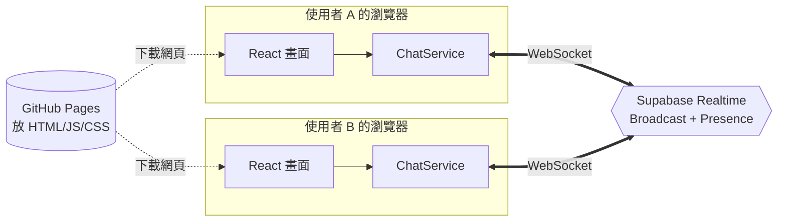
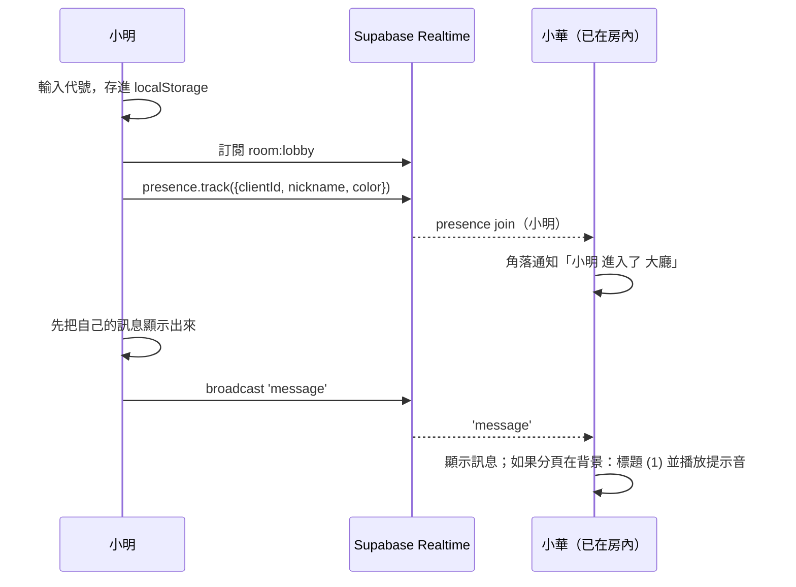
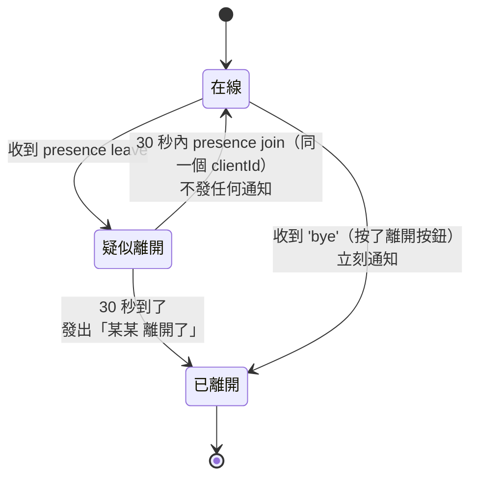

# 匿名聊天室 架構文件

> 依據：`docs/requirements.md`，加上需求訪談（第 1～17 題）整理出的決定。
> 讀者：之後要實作這個專案的人（包括未來的你）。

---

## 1. 一句話說明

一個放在 GitHub Pages 上的純前端網頁。使用者輸入代號後進入「大廳」，也可以開私人房間、用連結邀請別人。訊息和線上名單透過 Supabase Realtime（WebSocket）即時傳遞。**不保存任何訊息，所以不需要資料庫，也不需要自己的伺服器。**

---

## 2. 功能規格（使用者看得到的行為）

### 2.1 進入
| 項目 | 規則 |
|---|---|
| 代號長度 | 1～9 個字，中間可以有空白，空白也算字數；不能全部都是空白 |
| 字數怎麼算 | 用「肉眼看到的字」計算（emoji、中文、英文都算 1 個字） |
| 記住代號 | 存在瀏覽器裡，下次打開自動帶入，可以修改 |
| 代號重複 | 允許。每個人有自己的名字顏色，靠顏色分辨 |

### 2.2 房間
- 直接打開網站，會進入所有人共用的**大廳**。
- 可以開**私人房間**：名稱可取可不取，沒取的話自動產生（例如「房間 k3f9」）。開好後會得到一個專屬連結，**只有拿到連結的人進得來**，沒有公開的房間列表。
- 一個人可以**同時待在好幾個房間**，畫面上有房間列表可以切換，每個房間會顯示未讀數。
- 大廳一直都在，不能單獨離開。私人房間可以單獨離開（關掉那個房間）。
- 所有人都離開後，房間連結還是有效；再有人用這個連結進去時，會是一個空的房間。
- 同一個人的代號和顏色在每個房間都一樣。

### 2.3 訊息
- 不保存歷史，只看得到**進來之後**的訊息。
- 顯示方式採 Discord 風格：全部靠左，每則顯示「顏色名字、時間（HH:mm）、內容」。自己的訊息有淡色底，名字後面加上「（你）」。
- 每則最多 300 字。輸入框會顯示目前字數，超過時不能送出。
- 網址（`http://`、`https://` 開頭）會變成連結，點了在新分頁開啟。
- **回覆／引用**：可以對某則訊息按「回覆」，送出的訊息上方會顯示被引用那則的作者和前 50 字。點引用區塊時，如果原訊息還在畫面上，就捲動過去並短暫標亮。
- **表情回應**：固定 5 個（👍 ❤️ 😂 😮 😢）。點一下加上，再點一下取消，訊息下方顯示「👍 3」。滑鼠移上去（手機長按）會顯示是誰按的。
- **送出速度限制**：每秒最多 1 則。送太快會跳出提示「送太快了，請稍等」，輸入的內容會保留。
- **隱藏某人**：點某人的名字選擇「隱藏」，之後就看不到他的訊息和表情回應。隱藏只對自己有效，只在這次進入期間有效，可以從線上名單取消隱藏。

### 2.4 線上狀態與提示
- **線上名單**：電腦在右側欄一直顯示；手機上方顯示「👥 5 人在線」，點了才展開名單。名單只列出目前這個房間的人。
- **進出提示**：有人進來或離開時，畫面角落會跳出浮動通知（例如「小明 進入了 大廳」），約 4 秒後消失，不會留在聊天內容裡。短時間內很多人進出時，會合併成一則（例如「3 人進入了大廳」）。
- **離開的判定**：
  - 按「離開」按鈕：馬上算離開，其他人立刻收到提示，自己回到輸入代號的畫面。
  - 斷線、切到別的 App、鎖螢幕、關掉網頁：給 **30 秒緩衝**。30 秒內回來就當作沒離開，不會發出任何提示；超過 30 秒才算離開。
  - 回來時自動重新連線，不用再輸入代號。
- **斷線提示**：連線中斷時，畫面頂端會顯示「連線中斷，重新連線中…」。恢復後，聊天內容裡會插入一行灰字：「— 連線中斷期間的訊息無法顯示 —」。
- **新訊息提醒**：沒在看這個分頁的時候，分頁標題會變成「(3) 匿名聊天室」，並播放提示音；回到分頁後就恢復。右上角有靜音按鈕，設定會記在瀏覽器裡。

### 2.5 不做的功能
私訊、編輯或刪除訊息、「正在輸入…」、已讀狀態、管理員功能（踢人、封鎖、刪別人訊息）、圖片上傳、髒話過濾、訊息歷史。

---

## 3. 技術選擇與理由

### 3.1 前端：Vite + React + TypeScript
| 選擇 | 為什麼 |
|---|---|
| **React** | 這個畫面有很多「狀態一變，畫面就要跟著變」的地方：線上名單、表情回應數、未讀數、多個房間。React 最擅長處理這種情況，`/frontend-design` 產出的元件也通常是 React，可以直接沿用。 |
| **TypeScript** | 訊息、表情回應、線上狀態都要在不同使用者之間傳來傳去。先寫好資料格式（型別），格式寫錯時編譯就會報錯，不用等到上線才發現。 |
| **Vite** | 打包工具。設定很少，產出純靜態檔案（HTML／JS／CSS），可以直接放上 GitHub Pages。 |
| **網址用 `#`（hash routing）** | GitHub Pages 只能放靜態檔案。如果用 `/r/abc` 這種網址，重新整理時 GitHub 找不到這個檔案，會回傳 404。改用 `/#/r/abc`，`#` 後面的部分由瀏覽器處理，不會送到 GitHub，就不會有這個問題。 |
| **CSS Modules 或純 CSS** | 依 `/design` 產出的設計稿決定，不額外引入 UI 套件，讓畫面完全照設計走。 |

### 3.2 即時傳訊：Supabase Realtime，只用 Broadcast + Presence
Supabase Realtime 有三種功能，這個專案用其中兩種：

| 功能 | 用不用 | 用途 |
|---|---|---|
| **Broadcast**（廣播） | ✅ | 傳送訊息、表情回應、「我要離開了」通知。送出的資料會轉給同一個頻道的所有人，**不會存起來**，剛好符合「不保存歷史」。 |
| **Presence**（線上狀態） | ✅ | 線上名單。Supabase 會自動追蹤誰連著、誰斷了，並通知所有人。 |
| Postgres Changes（資料庫變更） | ❌ | 這是「資料庫有變動時通知大家」，要先把訊息寫進資料庫。我們不保存訊息，所以不用。 |

**每個房間對應一個頻道**：大廳是 `room:lobby`，私人房間是 `room:<房間ID>`。同時在好幾個房間，就是同時訂閱好幾個頻道。這些頻道共用同一條 WebSocket 連線，不會多佔連線數。

**結果：不用建資料表，不用寫 SQL，也不用寫後端程式。**

### 3.3 金鑰
Supabase 專案有兩種金鑰：

| 金鑰 | 樣子 | 能不能放前端 |
|---|---|---|
| **Publishable key**（舊介面叫 `anon` key） | `sb_publishable_...`（舊格式是 `eyJ...` 開頭的長字串） | ✅ **可以，而且一定會被看到**。它本來就是設計給瀏覽器用的，類似「門牌」：知道它只能做我們允許的事。 |
| **Secret key**（舊介面叫 `service_role` key） | `sb_secret_...` | ❌ **絕對不行**。它可以繞過所有權限。本專案完全用不到，**不要複製、不要放進任何檔案**。 |

**金鑰放在哪裡：**
- **本機開發**：放在專案根目錄的 `.env.local`，這個檔案要加進 `.gitignore`，不會上傳到 GitHub。
  ```
  VITE_SUPABASE_URL=https://xxxxxxxx.supabase.co
  VITE_SUPABASE_PUBLISHABLE_KEY=sb_publishable_xxxxxxxx
  ```
- **GitHub Pages 上線**：放在 GitHub repo 的 **Settings → Secrets and variables → Actions → Variables**，由 GitHub Actions 打包時帶入。
- **為什麼 publishable key 還要這樣放？** 它最後還是會出現在打包好的 JS 裡，任何人打開開發者工具都看得到，這是正常的。放在設定裡不是為了保密，而是為了：(1) 換專案時不用改程式碼；(2) 養成「金鑰不寫死在程式裡」的習慣，以後遇到真正需要保密的金鑰才不會出錯。

### 3.4 部署：GitHub Actions → GitHub Pages
推送到 `main` 分支時，GitHub Actions 會自動執行 `npm ci && npm run build`，再把 `dist/` 資料夾發佈到 GitHub Pages。`vite.config.ts` 的 `base` 要設成 `/<repo 名稱>/`。

---

## 4. 整體架構



- GitHub Pages 只負責把網頁檔案送給瀏覽器，送完就沒它的事了。
- 之後所有即時溝通，都是瀏覽器直接跟 Supabase Realtime 連線。
- 沒有我們自己的伺服器，也沒有資料庫。

### 4.1 關鍵設計：ChatService 介面（讓「先做前端、後接 Supabase」可行）
畫面元件**不直接呼叫 Supabase**，而是透過一個 `ChatService` 介面。這個介面有兩種實作：

| 實作 | 階段 | 原理 |
|---|---|---|
| `LocalChatService` | 第 1 階段 | 用瀏覽器內建的 `BroadcastChannel` API，讓**同一台電腦、同一個瀏覽器**的多個分頁互相傳訊。開兩個分頁就能模擬兩個人聊天，不需要任何帳號或金鑰。 |
| `SupabaseChatService` | 第 2 階段 | 用 Supabase Realtime，真正跨裝置。 |

用哪一種，看有沒有設定 `VITE_SUPABASE_URL` 來決定。換成 Supabase 時，**畫面程式碼完全不用改**。

```ts
interface ChatService {
  joinRoom(roomId: string, me: Me): RoomConnection;
}

interface RoomConnection {
  sendMessage(msg: OutgoingMessage): void;
  sendReaction(r: ReactionEvent): void;
  leave(): void;                                       // 主動離開（會通知別人）
  onMessage(cb: (m: ChatMessage) => void): Unsubscribe;
  onReaction(cb: (r: ReactionEvent) => void): Unsubscribe;
  onPresence(cb: (members: Member[]) => void): Unsubscribe;
  onMemberJoin(cb: (m: Member) => void): Unsubscribe;  // 已處理過 30 秒緩衝
  onMemberLeave(cb: (m: Member) => void): Unsubscribe; // 已處理過 30 秒緩衝
  onStatus(cb: (s: 'connected' | 'reconnecting') => void): Unsubscribe;
}
```

---

## 5. 資料格式

### 5.1 身分（沒有登入，只有臨時身分）
| 欄位 | 怎麼來 | 存在哪 |
|---|---|---|
| `clientId` | 第一次打開時隨機產生（`crypto.randomUUID()`） | `sessionStorage`：重新整理時不變，開新分頁就換一個。**一個分頁就是一個人。** |
| `nickname` | 使用者輸入 | `localStorage`：下次打開時自動帶入 |
| `color` | 由 `clientId` 算出來，從 12 種好辨識的顏色中挑一個 | 不用存，每次算出來都一樣 |

> 「隱藏某人」是用 `clientId` 記錄的，所以只在這次進入期間有效：對方開新分頁就會換一個 `clientId`。這就是第 10 題說的限制。

### 5.2 Broadcast 事件
```ts
// event: 'message'
type ChatMessage = {
  id: string;           // randomUUID
  clientId: string;
  nickname: string;
  color: string;
  text: string;         // ≤ 300 字
  replyTo?: {           // 引用：把摘要一起送出，因為收到的人可能沒有原訊息
    id: string;
    nickname: string;
    excerpt: string;    // 原文前 50 字
  };
};

// event: 'reaction'
type ReactionEvent = {
  messageId: string;
  emoji: '👍' | '❤️' | '😂' | '😮' | '😢';
  clientId: string;
  nickname: string;
  on: boolean;          // true = 加上，false = 取消
};

// event: 'bye'  —— 按「離開」按鈕時送出，讓別人不用等 30 秒
type ByeEvent = { clientId: string };
```

- **時間**：用**收到訊息時自己電腦的時間**，不用發送者的時間，避免大家時鐘不準時順序亂掉。自己送的訊息就用送出的時間。
- **自己的訊息**：送出時直接顯示在自己的畫面上，不等伺服器回傳（Broadcast 設定 `self: false`）。

### 5.3 Presence 資料
```ts
type Member = { clientId: string; nickname: string; color: string; joinedAt: number };
```
Presence 以 `clientId` 當 key。

### 5.4 房間網址
```
大廳：     https://<帳號>.github.io/<repo>/#/
私人房間：  https://<帳號>.github.io/<repo>/#/r/<房間ID>?name=<房間名稱>
```
- **房間 ID**：12 個隨機英數字（約 71 bits）。大約要猜幾十億兆次才猜得中，所以「知道連結才進得來」是靠這個 ID 夠難猜。
- **房間名稱**：直接放在網址裡，因為沒有資料庫可以存。沒取名的話，就用 ID 前 4 碼產生「房間 k3f9」。
- 目前加入的房間清單存在 `sessionStorage`，重新整理後會自動回到原本那些房間。

---

## 6. 重要流程

### 6.1 進入與送訊息


### 6.2 30 秒緩衝（離開判定）

- 緩衝由**每個收到通知的人自己的瀏覽器**計算，Supabase 不需要特別設定。
- 在「疑似離開」期間，這個人**還會留在線上名單裡**。
- 自己這邊：手機從背景回來時（`visibilitychange`），supabase-js 會自動重新連線，連上後重新送出 `presence.track()`。如果曾經斷線，就插入「連線中斷期間的訊息無法顯示」那行灰字。

### 6.3 送出速度限制
- 送出前檢查：距離上一則訊息不到 1 秒的話，就擋下並提示，輸入內容保留。
- 收到別人的訊息時也檢查：同一個 `clientId` 在 1 秒內送了好幾則，只顯示第一則。這是為了擋住改過程式碼、跳過限制的人。
- **限制要說清楚**：這是「防君子」等級的保護。真的想搗亂的人可以一直換 `clientId`。要做到真正無法繞過，需要伺服器端驗證，但目前需求不需要做到這個程度（見第 9 節）。

---

## 7. 前端結構

```
src/
├─ main.tsx
├─ App.tsx                  # 路由：沒有代號 → 輸入畫面；有代號 → 聊天畫面
├─ config.ts                # 讀 VITE_ 環境變數，決定用哪種 ChatService
├─ chat/
│  ├─ types.ts              # 第 5 節的型別
│  ├─ ChatService.ts        # 介面
│  ├─ LocalChatService.ts   # 第 1 階段：BroadcastChannel
│  ├─ SupabaseChatService.ts# 第 2 階段：Supabase Realtime
│  └─ presenceGrace.ts      # 30 秒緩衝邏輯（兩種實作共用）
├─ state/
│  ├─ identity.ts           # clientId / nickname / color
│  ├─ rooms.ts              # 已加入的房間、每個房間的訊息與未讀數
│  └─ settings.ts           # 靜音、隱藏名單
├─ lib/
│  ├─ textLength.ts         # 用 Intl.Segmenter 計算字數
│  ├─ linkify.ts            # 把網址切成文字和連結片段（不用 innerHTML）
│  ├─ rateLimit.ts
│  ├─ notify.ts             # 分頁標題未讀數、提示音
│  └─ roomUrl.ts            # 產生和解析房間網址
└─ components/
   ├─ NicknameScreen.tsx
   ├─ ChatLayout.tsx        # 房間列表 | 聊天區 | 線上名單（手機版會重新排列）
   ├─ RoomList.tsx
   ├─ MessageList.tsx / MessageItem.tsx / ReplyPreview.tsx / ReactionBar.tsx
   ├─ Composer.tsx          # 輸入框、字數、回覆中提示
   ├─ MemberList.tsx        # 右側欄；手機版是可展開的面板
   ├─ Toasts.tsx            # 浮動進出通知
   ├─ ConnectionBanner.tsx
   └─ CreateRoomDialog.tsx  # 取名、產生連結、複製按鈕
```

### 7.1 安全細節
- **一律不用 `innerHTML` / `dangerouslySetInnerHTML`**。訊息內容都當作純文字顯示，網址由 `linkify` 切成 `<a>` 元素。這樣別人傳 `<script>` 也只會顯示成文字。
- 連結只接受 `http:` 和 `https:`，並加上 `target="_blank" rel="noopener noreferrer"`。
- 收到的任何資料都**再檢查一次**（字數、欄位型別、emoji 是否在 5 個之內），不合格就丟掉，因為別人可能改過程式碼。

### 7.2 提示音
手機瀏覽器規定：使用者沒操作過之前，網頁不能自己播放聲音。按「進入」的那一下就算使用者操作，所以按下去的同時先把音效準備好，之後就能正常播放。

---

## 8. Supabase 設定步驟（第 2 階段才做）

1. 到 <https://supabase.com> 註冊，按 **New project**，Region 選離使用者近的（例如 Tokyo 或 Singapore）。資料庫密碼隨便設一個強密碼，存好就好，本專案用不到。
2. 進入 **Project Settings → API Keys**，複製：
   - Project URL
   - **Publishable key**（舊介面叫 `anon` `public`）
   - ⚠️ **Secret / service_role key 不要複製。**
3. 到 **Realtime → Settings**，確認沒有開啟「只允許 private channels」。本專案用公開頻道，靠房間 ID 難猜來保護私人房間。
4. **不用建任何資料表。**
5. 把兩個值填進本機的 `.env.local` 和 GitHub repo 的 Actions Variables（見 3.3）。
6. 本機用兩個不同的瀏覽器（例如 Chrome 和手機）測試跨裝置聊天。

**免費方案要注意：**
- 同時連線人數和每月訊息量都有上限（以 Supabase 官網目前公告為準），一個分頁算 1 條連線。小型聊天室通常用不完。
- 專案**一段時間沒有使用會自動暫停**，需要到後台手動恢復。

---

## 9. 已知限制與取捨

| 限制 | 原因 | 如果以後要改 |
|---|---|---|
| 頻道是公開的。有心人拿到 publishable key（任何人都拿得到）後，可以自己寫程式連進大廳，或連進他知道 ID 的房間 | 沒有登入，也沒有伺服器 | 改用 Supabase 匿名登入 + Realtime Authorization（private channel + RLS） |
| 速度限制和字數限制可以被繞過 | 只在前端檢查 | 加一個 Supabase Edge Function 轉送訊息，由伺服器檢查 |
| 「隱藏某人」換個分頁就失效 | 沒有固定身分 | 同上，用匿名登入給每個裝置固定 ID |
| 同一個人開兩個分頁，會變成兩個「人」 | 一個分頁就是一個 `clientId` | 可以接受 |
| 複製分頁時，兩個分頁會共用同一個 `clientId` | 瀏覽器會把 `sessionStorage` 一起複製過去 | 啟動時用 `BroadcastChannel` 檢查有沒有重複，重複就換新的 ID |
| 關掉網頁後，其他人要等 30 秒才看到「離開了」 | 這是第 9 題要求的緩衝，關閉網頁和暫時斷線分不出來 | 可以接受 |

---

## 10. 實作順序

**第 1 階段：前端（先上線看得到）**
1. 用 `/design` 做出畫面設計：輸入代號畫面、聊天畫面（電腦版、手機版）、建立房間對話框。
2. 建立 Vite + React + TS 專案，設定 GitHub Actions 部署到 Pages，先放一個「Hello」頁面確認流程能跑。
3. 用 `/frontend-design` 依照設計做出元件。
4. 完成 `LocalChatService`（BroadcastChannel），開兩個分頁就能互聊，把第 2 節的功能全部做出來並測試。
5. 部署到 GitHub Pages。這時線上版只能「同一個瀏覽器的多個分頁」互聊，這是預期中的行為。

**第 2 階段：接上 Supabase**

6. 依第 8 節設定 Supabase 專案和金鑰。
7. 完成 `SupabaseChatService`。
8. 用電腦＋手機實際測試：進出提示、30 秒緩衝（手機鎖螢幕 10 秒再回來、鎖 60 秒再回來）、多個房間、表情回應、速度限制。
9. 在 GitHub 設定 Variables 後重新部署。
